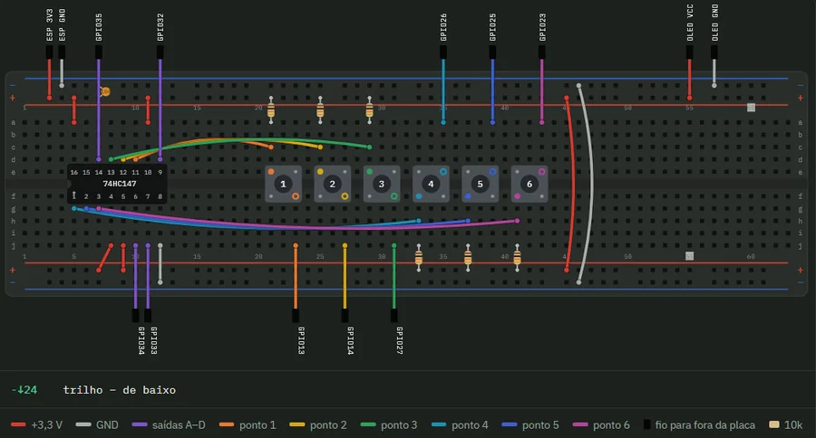

# Lucas Guerra Lima

Computer Engineering student at SENAI CIMATEC, Salvador (BA), Brazil.
C++, Python, TypeScript, Java.

## [ESP32-Braille](https://github.com/StikerSD/ESP32-Braille)

6-dot braille keyboard. A chord is pressed and released; the matching letter is
shown on an SSD1306 OLED.

The 74HC147 priority encoder reports only the highest active input, so a chord
cannot be read in a single pass. Each dot already identified is masked by driving
its GPIO high — the pin acts as a programmable ground — and the encoder is read
again until no input remains. Dots are debounced with a confirmation counter.

**Stack:** `C++` `ESP32` `74HC147` `SSD1306` `I2C` `PlatformIO`

